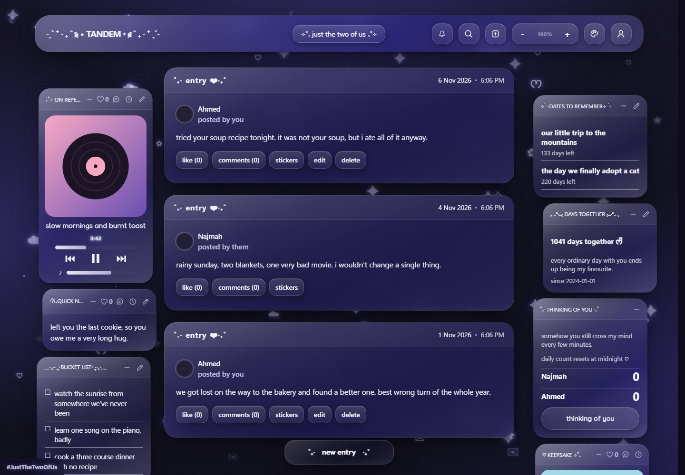
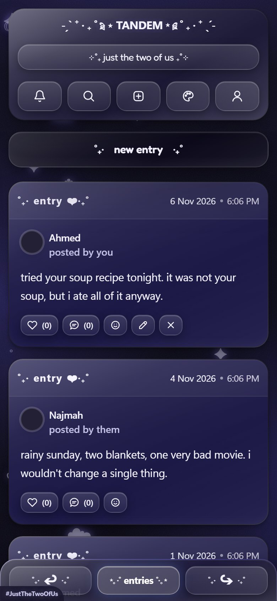
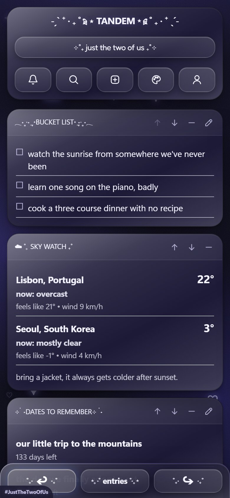
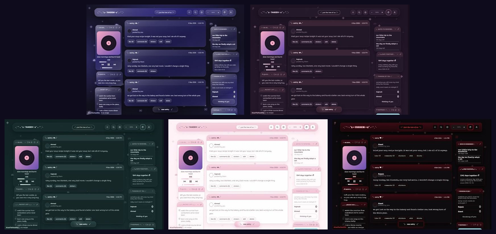

# Tandem

A private diary for two people, built as a template. It installs like an app, works offline, and needs no server or database: everything is saved in the browser.



<p align="center">
  
  &nbsp;
  
</p>

## Run it

```bash
npm install
npm run dev
```

Open http://localhost:5173 and sign in with either account from `src/app-config.js`. Any password works in this local version.

| Command | What it does |
|---|---|
| `npm run dev` | Rebuilds on change and serves `dist/` on port 5173 |
| `npm run build` | Builds the site into `dist/` |
| `npm run preview` | Builds once and serves it |

## What's inside

- **Timeline:** entries with words, photos, songs and stickers, plus likes, comments, replies and @mentions
- **Widgets:** on repeat, quick note, dates to remember, bucket list, sky watch, thinking of you, days together, and a keepsake photo for each person
- **Custom widgets:** add your own from the + icon in the toolbar; edit or delete them any time
- **Photo editor:** crop, rotate, filters, drawing and text for keepsakes
- **Inbox:** in-app notifications about what the other person did
- **Themes:** nebula (the default), dusk, pine, blossom and ember, each with its own launch screen and icon
- **PDF export:** the whole diary as a printable book
- **Installable:** a service worker and web manifest

## Themes

Nebula, dusk, pine, blossom and ember:



## Make it yours

1. **`src/app-config.js`:** app name, the two people, starting dates, sample entries and widget content, and weather cities. Each person owns one keepsake widget. Set `SAMPLE_ENTRIES` to an empty list for a blank timeline. For GIF and sticker search, add a free key from developers.giphy.com as `GIPHY_API_KEY`.
2. **Name:** also change it in `index.html`, `public/site.webmanifest` and `package.json`.
3. **Art:** edit the logo or colours in `scripts/make-art.cjs`, then run:

   ```bash
   npm install --no-save sharp
   ```

   ```bash
   node scripts/make-art.cjs
   ```

4. **Themes:** edit `src/themes/*.css` directly. `nebula.css` is generated, so change `scripts/theme-source/nebula-extras.css` and run `node scripts/make-nebula-theme.mjs` instead.

## Add a real backend

All data goes through `src/local-store.js`. A replacement has to offer the same small API:

- `from(table)` with `select`, `insert`, `update`, `delete`, `eq`, `gte`, `in`, `ilike`, `order`, `limit`, `single` and `maybeSingle`. Awaiting one gives `{ data, error }`.
- `storage.from(bucket)` with `upload` and `getPublicUrl`
- `auth` with `getSession`, `getUser`, `signInWithPassword`, `signOut`, `refreshSession` and `onAuthStateChange`
- `channel(name)` with `on("change", { table }, callback)`, `subscribe` and `unsubscribe`

Until you replace it:

- Data stays in one browser, so the two people only share a diary on the same device.
- Passwords aren't checked.
- Photos are stored inside the rows as data URLs, which will fill browser storage over time.
- Changes sync between tabs, not between devices.

Phone push notifications were left out because they need a server.
